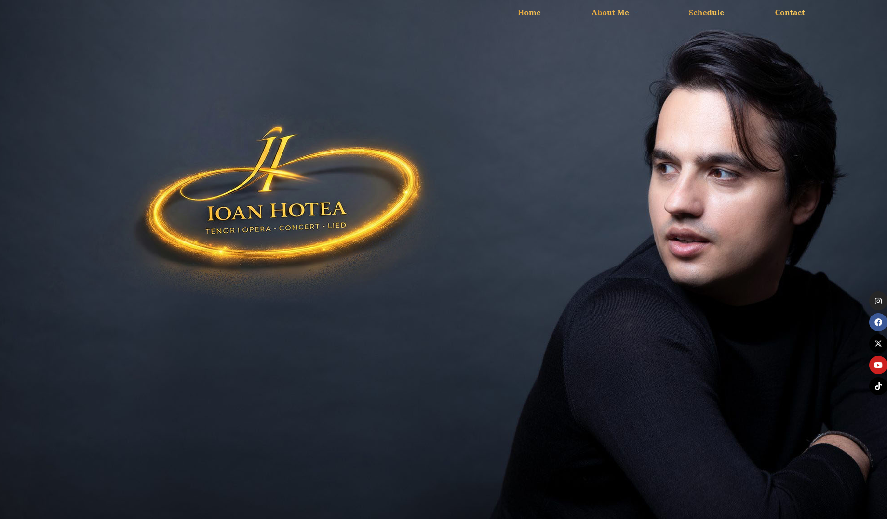
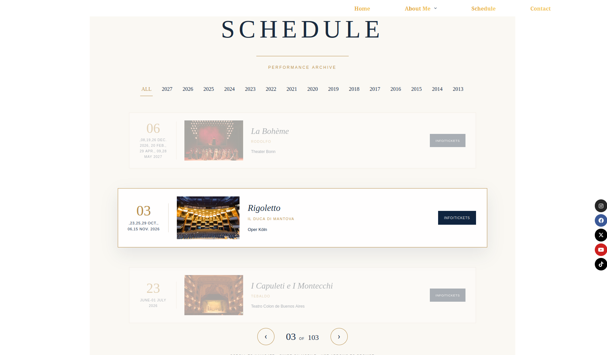

# Classical & Opera Artist Digital Portfolio

> An elegant, production-grade artist portfolio and performance schedule built with WordPress and Elementor.  
> 🌐 **Live Website:** [ioanaugustinhotea.com](https://ioanaugustinhotea.com)

## 📸 Visual Showcase

### Desktop Experience
| Homepage View | Schedule / Biography View |
| :---: | :---: |
|  |  |

### Mobile Experience
| Mobile Layout |
| :---: |
|  |

---

## 📌 Project Overview

This repository contains the architecture, assets, and exported Elementor design kit for **[ioanaugustinhotea.com](https://ioanaugustinhotea.com)**, the official web platform for international opera tenor **Ioan Hotea**. 

Crafted with an editorial aesthetic tailored to the classical music and performing arts industry, the website delivers a refined digital identity for casting directors, opera house managements, press media, and audiences worldwide.

---

## 🏛️ Website Structure & Core Modules

* **Hero Landing (Home):** High-impact visual branding featuring prominent production imagery, featured upcoming engagements, and immediate navigation paths for press and booking agents.
* **Artistic Biography:** A comprehensive chronological narrative detailing career milestones, major venue debuts (e.g., Royal Opera House, Wiener Staatsoper), competition accolades, and vocal repertoire.
* **Performance Schedule:** A structured, accessible itinerary tracking current and upcoming opera productions, concert dates, host venues, and ticket reservation links.
* **Contact & Representation:** A dedicated booking portal featuring international agency contact details, management inquiries, and direct communication channels.

---

## ✨ Design & Technical Highlights

* **Refined Typography & Visual Hierarchy:** Built with an editorial layout, clean negative space, and a curated color palette that reflects the dignity and prestige of classical performing arts.
* **Mobile-First Responsiveness:** Strict viewport adaptations across mobile, tablet, and desktop screens, ensuring seamless navigation for casting directors viewing the site on handheld devices.
* **Performance & Asset Optimization:** Integrated image compression, asset unloading, and caching configurations to support high-resolution stage photography without compromising load speeds.
* **Lead Capture & Anti-Spam Security:** Secure inquiry forms with automated notifications and anti-spam protocols for direct booking and press inquiries.

---

## 🛠️ Tech Stack & Plugin Architecture

| Layer | Component | Functionality |
| :--- | :--- | :--- |
| **Core Platform** | WordPress | Content management, media library, and schedule updates |
| **Visual Builder** | Elementor | Component layout engine and responsive styling |
| **Base Theme** | Blocksy | Fast, lightweight theme skeleton with minimal CSS footprint |
| **Add-on Suite** | Essential Addons / ElementsKit | Custom interactive widgets and expanded UI elements |
| **Form Engine** | WPForms | Agency inquiries, fan contact, and message routing |
| **Optimization** | LiteSpeed Cache & Asset CleanUp | Server-level caching, script deferral, and asset minification |

---

## 📂 Repository File Structure

```text
.
├── screenshots/
│   ├── desktop.png              # Full-resolution desktop view
│   ├── mobile.png               # Mobile viewport preview
│   └── schedule.png             # Performance calendar interface
├── template/
│   └── artist-website-kit.zip   # Exported Elementor kit (content, styles, tokens)
└── README.md                    # Project documentation and specifications